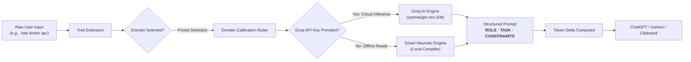

# 🏔️ Trail — Prompt Optimizer

<p align="center">
  
</p>

<p align="center">
  <b>A clearer path to better prompts.</b><br>
  Transforms messy, informal user inputs into structured, token-efficient, high-precision AI prompts directly inside ChatGPT & Gemini.
</p>

<p align="center">
  <a href="https://bethuel369.github.io/Trail-extension/"></a>
  <a href="https://github.com/Bethuel369/Trail-extension"></a>
  <a href="trail-extension.zip"></a>
  <a href="#license"></a>
</p>

---

## 🌟 Try the Live Showcase Website!

> [!TIP]
> 👉 **Explore the interactive demo and landing page online here:**  
> ### 🔗 **[https://bethuel369.github.io/Trail-extension/](https://bethuel369.github.io/Trail-extension/)** 🚀
> 
> *Test drive domain transformations in real-time, inspect token estimations, and download the latest release directly from your browser!*

---

## 🎨 What is Trail?

Most people prompt AI the way they talk — casually, incompletely, and ambiguously. This causes Large Language Models to make assumptions, produce generic answers, or hallucinate.

**Trail** bridges the gap between human thought and LLM comprehension. With a single click or **Alt+Shift+T**, it reframes your raw ideas into structured prompts consisting of:
- 🎭 **ROLE** — Defines a hyper-specific, senior-level persona with the right technical pedigree.
- 🎯 **TASK** — Unambiguous, imperative directive articulating the exact deliverable and milestones.
- 📐 **CONSTRAINTS & CONTEXT** — Format rules, libraries to prefer, and anti-patterns to avoid.

```
       [ Messy Draft ]  ──►  make a script to clean missing values in pandas
                                      │
                                      ▼
                        🏔️ TRAIL PROMPT OPTIMIZER
                                      │
                                      ▼
   ┌────────────────────────────────────────────────────────────────────────┐
   │  ### ROLE                                                              │
   │  Lead Data Scientist and Quantitative Python Architect (pandas, NumPy) │
   │                                                                        │
   │  ### TASK                                                              │
   │  Architect and implement a production-grade routine to detect, audit,  │
   │  and clean missing values in a pandas DataFrame.                       │
   │  1. Quantify sparsity and column-wise null distributions.              │
   │  2. Implement configurable imputation and conditional row dropping.    │
   │  3. Return the sanitized DataFrame and an audit summary report.        │
   │                                                                        │
   │  ### CONSTRAINTS & CONTEXT                                             │
   │  - Prefer vectorized operations over iterative .iterrows() loops.      │
   │  - Enforce strict type annotations and PEP 8 compliance.               │
   │  - Guard against mixed dtype coercion and excessive memory overhead.   │
   └────────────────────────────────────────────────────────────────────────┘
```

---

## ✨ Key Features

| Feature | Description | Highlight |
| :--- | :--- | :---: |
| ⚡ **Inline Page Button** | Injects directly beneath prompt boxes on `chatgpt.com` and `gemini.google.com` | Zero copy-pasting |
| 🏔️ **Yosemite Sunset Popup** | Retro sunset panorama toolbar popup for use across any AI assistant | Works anywhere |
| 🎯 **11 Domain Rubrics** | Presets crafted for Data Science, Software Eng, Quant Finance, SecOps & more | Expert tuning |
| 📊 **Token Estimator** | Estimated token count (~4 chars per token) comparing raw drafts with rewrites | Cost aware |
| 🚀 **Dual Engine Power** | Fast Groq Cloud AI inference OR smart offline heuristic compiler | Flexible & instant |
| 🔒 **Zero Telemetry** | No tracking scripts, no Google Analytics, no Trail intermediary servers | Transparent & private |

---

## 🧭 How It Works Under The Hood



---

## 🎯 Supported Domain Presets

Trail includes 11 carefully calibrated domains out of the box:

- 🐍 **Data Science & Python** — Vectorized pandas/numpy logic, PEP 8, reproducible metrics.
- 💻 **Software Engineering** — Clean architecture, design patterns, testing, error handling.
- 📈 **Quantitative Finance** — Monte Carlo simulations, VaR, Greeks, Sharpe ratio.
- 🤖 **Machine Learning & MLOps** — Loss formulations, validation splits, drift mitigation.
- 📝 **Technical Writing & Docs** — Diátaxis framework, API specifications, code blocks.
- 🛡️ **Cybersecurity** — OWASP Top 10, CWE mitigation, threat modeling, least privilege.
- 🚀 **Product Management** — JTBD, user stories, discovery briefs, success KPIs.
- 💼 **Business & Strategy** — MECE frameworks, unit economics, risk matrices.
- 🎓 **Education & Research** — Scaffolded pedagogy, primary literature conventions.
- 🎨 **Creative Writing** — Vivid sensory anchors, emotional stakes, voice preservation.
- 🌐 **General / Default** — All-purpose prompt structuring for daily tasks.

---

## 📦 Quick Installation (Chromium Browsers)

Trail is an open-source unpacked extension compatible with **Chrome**, **Brave**, **Edge**, **Arc**, and **Opera**.

### 1️⃣ Download
- Download [`trail-extension.zip`](trail-extension.zip) or clone this repo:
  ```bash
  git clone https://github.com/Bethuel369/Trail-extension.git
  ```
- Or check [GitHub Releases](https://github.com/Bethuel369/Trail-extension/releases) for tagged releases.

### 2️⃣ Extract
- Unzip the archive to a permanent folder on your machine.

### 3️⃣ Load into Browser
1. In your Chromium browser, go to `chrome://extensions` (or `edge://extensions`).
2. Toggle on **Developer mode** in the top-right corner.
3. Click **Load unpacked** in the top-left corner.
4. Select the folder that directly contains `manifest.json` (either `trail` if cloning the repo, or the extracted `trail-extension` folder).

> [!NOTE]
> **Developer Mode Banner:** Chromium browsers display a standard warning banner for extensions loaded via developer mode upon browser launch. This is expected behavior for unpacked open-source extensions not loaded from the Chrome Web Store.

### 4️⃣ Pin & Start Prompting!
- Pin **Trail** to your browser toolbar.
- Visit [ChatGPT](https://chatgpt.com) or [Gemini](https://gemini.google.com) to see the Trail button appear directly beneath the chat box!
- Prefer the keyboard? Click into the chat box and press **Alt+Shift+T** (rebind it at `chrome://extensions/shortcuts`).
- Don't like the rewrite? Hit **Undo** in the toast to restore your original draft.

---

## 🔑 Groq API Setup (Optional)

Trail functions completely offline using its local heuristic compiler. To enable generative AI rewrites:

1. Grab a free API key from [Groq Console](https://console.groq.com/keys).
2. Open the Trail popup from your browser toolbar.
3. Expand **Groq API key** at the bottom.
4. Paste your key and click outside. Your key is stored in your local browser profile (`chrome.storage.local`).

---

## 📁 Repository Structure

```
Trail - Extension/
├── assets/                     # Brand marks & vector illustrations
│   ├── trail-mark.svg          # Favicon & badge icon
│   ├── trail-logo.svg          # Brand lockup (dark)
│   └── trail-logo-light.svg    # Brand lockup (light)
├── trail/                      # Chrome Extension source code (Manifest V3)
│   ├── icons/                  # High-res extension icons (16, 32, 48, 128px)
│   ├── background.js           # Service worker (Groq requests + keyboard shortcut)
│   ├── content.js              # DOM injection script for ChatGPT & Gemini
│   ├── inject.css              # Styling for inline page button
│   ├── manifest.json           # Manifest V3 configuration (v0.5.0)
│   ├── popup.html              # Yosemite vintage popup markup
│   ├── popup.js                # Popup event handling & clipboard writing
│   ├── shared.js               # Domain presets, local heuristics & token logic
│   ├── styles.css              # Popup styling & responsive layout
│   └── LICENSE                 # MIT License copy
├── index.html                  # GitHub Pages interactive showcase website
├── trail-extension.zip         # Pre-packaged ready-to-load extension archive
├── LICENSE                     # MIT License
└── README.md                   # Project documentation
```

---

## 🛡️ Privacy & Security Architecture

- 🚫 **Zero Telemetry:** No tracking pixels, no Google Analytics, no Trail analytics servers.
- 💻 **Offline Heuristic Mode:** When running without an API key, 100% of parsing and milestone synthesis executes client-side on your device.
- 📡 **Direct-to-API Calls:** When an optional Groq key is used, requests are sent directly over HTTPS from your browser to `api.groq.com`.
- 🔐 **Credential Storage:** Your API key is stored unencrypted in `chrome.storage.local` within your local browser profile folder on your machine.

---

## 👤 Author

Developed by **[Bethuel Ngetich](https://github.com/Bethuel369)**  
Feel free to open an issue or submit a pull request if you have ideas for new domain presets or features!

---

## 📄 License

This project is licensed under the [MIT License](LICENSE).
